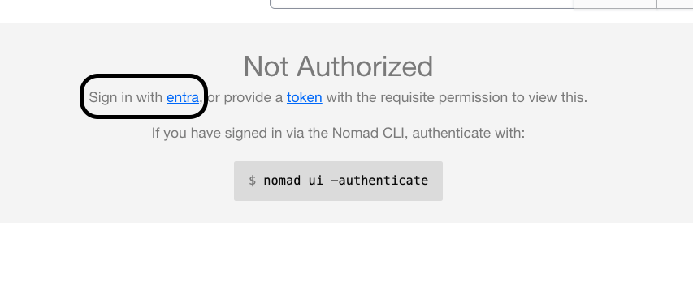
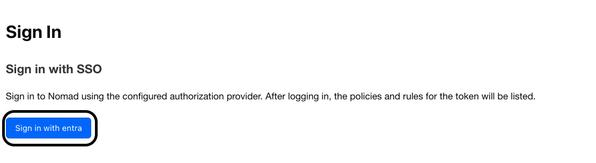
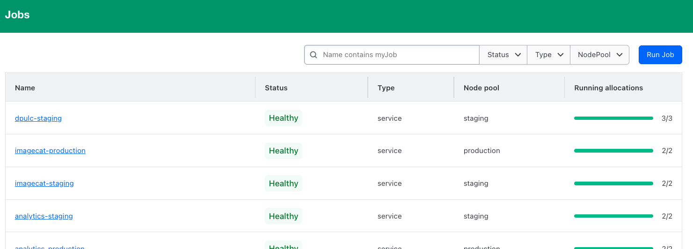
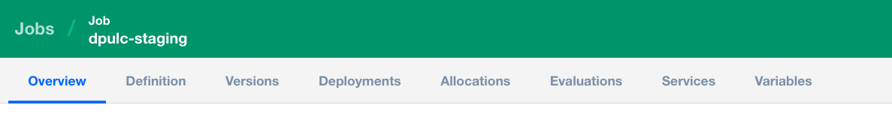
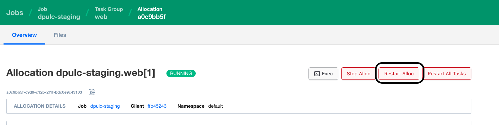
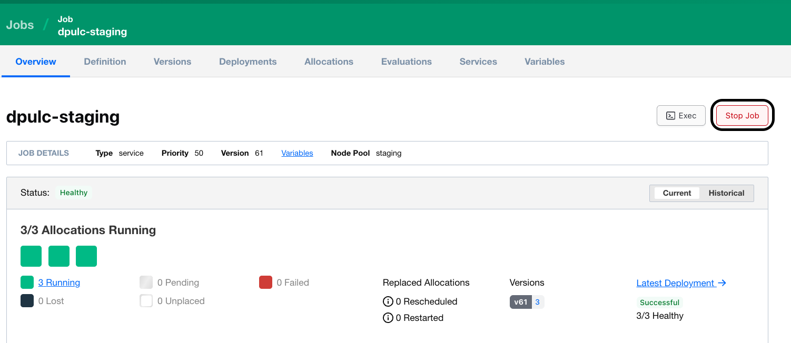
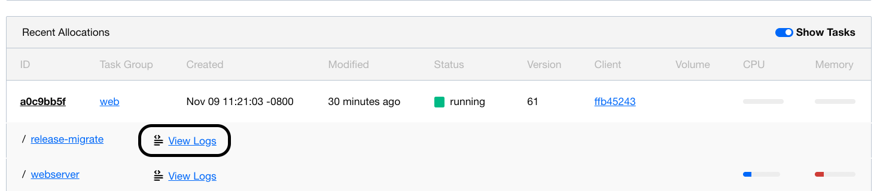
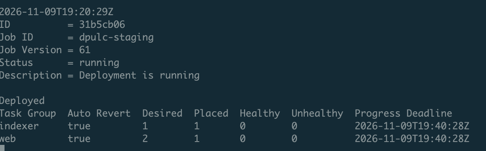
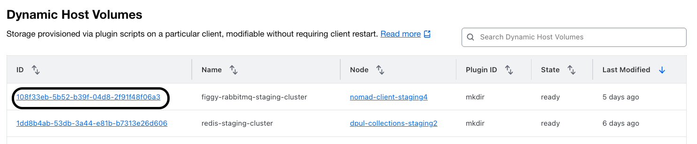

# Nomad

[Hashicorp Nomad](https://developer.hashicorp.com/nomad) is a platform we use for deploying and managing containers.

You can find the documentation about how we install both Nomad and Consul in the [pul_nomad role](https://github.com/pulibrary/princeton_ansible/tree/main/roles/pul_nomad).

The goal of this documentation is to show how to perform common operational tasks in Nomad. It will be expanded on as folks have questions.

## Login

1. https://nomad.lib.princeton.edu
1. Click "Sign in with entra" link

1. Click "Sign in with entra" button

1. Login

## View What's Running in Nomad

"Jobs" are individual services that are running on Nomad, each one corresponds to a single `.hcl` file.

1. Go to `https://nomad.lib.princeton.edu/ui/jobs`

1. Click the Name of the job you're interested in.

### Terminology

**HCL**: The file that defines how to deploy and manage the application. [Example for pulmap](https://github.com/pulibrary/pulmap/blob/929f93981f6e13c98b98a94b7e44c9cbf3597099/config/deploy/staging.hcl).

**Deployment**: A specific application deploy, which may generate several allocations. This is what kicks off when you run the deployment commands below.

**Allocations**: Individual services running on a specific client. An allocation is all on the same server, but may be made up of multiple processes.

**Task Groups**: Groups of tasks, that are scaled together. For example, you might want 3 instances of the "web" task group so that 3 instances of Pulmap's web server runs. May consist of multiple tasks.

**Task**: Individual processes running on a client, within an allocation.

An allocation is an instance of a task group running on a server.

In a sentence: If I want 3 web servers for Pulmap, then I want to adjust the HCL to deploy 3 of the "web" task group and deploy it, which will create 3 allocations on 3 clients, each one an instance of the "web" task group, and each of those groups will launch a process that runs the docker image for pulmap.

### Tabs



**Overview**: Displays all the allocations, task groups, tasks, and deployments 
**Definition**: View currently deployed HCL, and allow editing it.
**Versions**: View all previous deployments, the changes in definition that were part of that deployment, and allow rolling back to any version.
**Deployments**: List recent deployments
**Allocations**: List currently running and recent allocations.
**Evaluations**: List of events the Nomad system saw, with timestamps.
**Services**: List of services that get registered with Consul.
**Variables**: List of variables that the job has access to. These get deployed with `princeton_ansible` and often contains the per-job secrets.

## Restart a Service

It should be rare to need to restart a service - if the service is found to be unhealthy, Nomad will automatically restart or even move it to another node.

But if you do, there are two ways to restart a service:

### Zero Downtime

If you need zero downtime, then go to the "Allocations" tab, click each "running" allocation, and then click "Restart Alloc" on each one, waiting for each to recover before doing the next.



### Small Downtime

In the Job window, click "Stop Job", wait for it to say "0 Allocations Running", then click "Start Job"



## View Logs

Any job that has "logging" in its first service should be sending logs to Signoz, so you can browse logs there. For example, [dpul-collections](https://signoz.lib.princeton.edu/logs/logs-explorer?options=%7B%22selectColumns%22%3A%5B%7B%22name%22%3A%22timestamp%22%2C%22signal%22%3A%22logs%22%2C%22fieldContext%22%3A%22log%22%2C%22fieldDataType%22%3A%22%22%2C%22isIndexed%22%3Afalse%7D%2C%7B%22name%22%3A%22body%22%2C%22signal%22%3A%22logs%22%2C%22fieldContext%22%3A%22log%22%2C%22fieldDataType%22%3A%22%22%2C%22isIndexed%22%3Afalse%7D%5D%2C%22maxLines%22%3A1%2C%22format%22%3A%22raw%22%2C%22fontSize%22%3A%22small%22%7D&relativeTime=30m&compositeQuery=%257B%2522queryType%2522%253A%2522builder%2522%252C%2522builder%2522%253A%257B%2522queryData%2522%253A%255B%257B%2522dataSource%2522%253A%2522logs%2522%252C%2522queryName%2522%253A%2522A%2522%252C%2522aggregateOperator%2522%253A%2522count%2522%252C%2522aggregateAttribute%2522%253A%257B%2522id%2522%253A%2522----%2522%252C%2522dataType%2522%253A%2522%2522%252C%2522key%2522%253A%2522%2522%252C%2522type%2522%253A%2522%2522%257D%252C%2522timeAggregation%2522%253A%2522rate%2522%252C%2522spaceAggregation%2522%253A%2522sum%2522%252C%2522filter%2522%253A%257B%2522expression%2522%253A%2522service.name%2520in%2520%255B%27dpulc-production%27%255D%2522%257D%252C%2522aggregations%2522%253A%255B%257B%2522expression%2522%253A%2522count%28%29%2520%2522%257D%255D%252C%2522functions%2522%253A%255B%255D%252C%2522filters%2522%253A%257B%2522items%2522%253A%255B%257B%2522id%2522%253A%2522bf1f6eea-a71e-4a68-bdab-2f2391292f40%2522%252C%2522op%2522%253A%2522in%2522%252C%2522key%2522%253A%257B%2522id%2522%253A%2522service.name%2522%252C%2522key%2522%253A%2522service.name%2522%252C%2522dataType%2522%253A%2522string%2522%252C%2522type%2522%253A%2522resource%2522%257D%252C%2522value%2522%253A%2522dpulc-production%2522%257D%255D%252C%2522op%2522%253A%2522AND%2522%257D%252C%2522expression%2522%253A%2522A%2522%252C%2522disabled%2522%253Afalse%252C%2522stepInterval%2522%253Anull%252C%2522having%2522%253A%257B%2522expression%2522%253A%2522%2522%257D%252C%2522limit%2522%253Anull%252C%2522orderBy%2522%253A%255B%255D%252C%2522groupBy%2522%253A%255B%255D%252C%2522legend%2522%253A%2522%2522%252C%2522reduceTo%2522%253A%2522avg%2522%252C%2522source%2522%253A%2522%2522%257D%255D%252C%2522queryFormulas%2522%253A%255B%255D%252C%2522queryTraceOperator%2522%253A%255B%255D%257D%252C%2522promql%2522%253A%255B%257B%2522name%2522%253A%2522A%2522%252C%2522query%2522%253A%2522%2522%252C%2522legend%2522%253A%2522%2522%252C%2522disabled%2522%253Afalse%257D%255D%252C%2522clickhouse_sql%2522%253A%255B%257B%2522name%2522%253A%2522A%2522%252C%2522legend%2522%253A%2522%2522%252C%2522disabled%2522%253Afalse%252C%2522query%2522%253A%2522%2522%257D%255D%252C%2522id%2522%253A%25224dbb187b-6df3-4e05-9dd2-b502649ffe70%2522%252C%2522unit%2522%253A%2522%2522%257D).

If it's not, you can still view the logs in the Nomad interface by going to "Recent Allocations" in the Jobs interface and clicking "View Logs" next to the task you want to see logs for.



## Deployment

If you're in `princeton_ansible` and deploying a service, not an application we've developed, then read [Ansible Nomad Deployment](#ansible-nomad).

If you're in a code base that builds an image and we write the software for, then read [Application Nomad Deployment](#application-nomad-deployment).

### Ansible Nomad Deployment

Every service in `princeton_ansible` that runs on Nomad has a playbook that provisions storage, configures database access, pushes up variables, etc. To deploy main, simply run the playbook. For example:

#### Deploy Staging

`ansible-playbook playbooks/nomad_redis.yml`

To deploy a branch:

1. Ensure your branch is committed and pushed to github.
2. `BRANCH=<my_branch> ansible-playbook playbooks/nomad_redis.yml`

#### Deploy Production

`ansible-playbook playbooks/nomad_redis.yml -e runtime_env=production`

To deploy a branch:

1. Ensure your branch is committed and pushed to github.
2. `BRANCH=<my_branch> ansible-playbook playbooks/nomad_redis.yml -e runtime_env=production`

### Application Nomad Deployment

Applications generally have provisioning handled in `princeton_ansible` (database connections, storage, load balancer setup, etc), but deployment happens in the code base as that's what builds the image. The examples below are for `pulmap`, a rails app running on Nomad.

#### Provision

In `princeton_ansible`:

**Staging**: `ansible-playbook playbooks/pulmap.yml`
**Production**: `ansible-playbook playbooks/pulmap.yml -e runtime_env=production`

#### Deploy

In `pulmap`

**Staging**: `bin/deploy staging`
**Production**: `bin/deploy production`



#### Deploy a Branch

Deploying branches requires the docker image for that branch got built, which happens on a PR to main.

1. Push branch up
2. Create a PR (maybe a draft PR)
3. `BRANCH=<my_branch> bin/deploy staging`

## Stateful Services

Some services require storing data long-term.

When possible, use highly available stateful services that store in a cluster and can recover a node that's been wiped. A stateful service is locked to a single client (where the data is). Distributed or shared storage like NFS is often too slow for the services that need this kind of persistently available storage (like databases.)

Right now we use what Nomad calls "Dynamic Host Volumes," which means we can use `princeton_ansible` to tell Nomad "make a folder on one of the clients under `/container_data`, and let a client claim it". Given the complexity, the fewer of these we have the better.

### Wiping a service

First, stop the job you'd like to wipe.

You can see current dynamic host volumes in the [Storage Tab](https://nomad.lib.princeton.edu/ui/storage)



Find the service you'd like to wipe, and get its storage IDs. Then, in `princeton_ansible`, do this:

1. `export NOMAD_ADDR=https://nomad.lib.princeton.edu`
1. `nomad login -method=entra`
1. `nomad volume delete -type host <id>`
1. Rerun the ansible-playbook for that service to recreate the volume.

### Finding the Data

All of the data is in `/container_data/<idhere>` on the client the dynamic host volume is on.

```bash
root@dpul-collections-staging2:/container_data# ls
1dd8b4ab-53db-3a44-e81b-b7313e26d606  ef2a23c8-ee4a-1d1b-857e-a8a967e3c1a9
```

## FAQ

1. Why are there staging servers on the production cluster?

Staging clients are on the production cluster to prevent the way we handle staging from deviating too far from how we handle production. Staging clients are in a "staging" node pool, run in the VMWare "dev" environment, and only communicate with the production cluster to determine what to deploy and how.

It technically also allows us to do things like quickly deploy production to staging infrastructure or vice versa in the event of an emergency downtime.

We may revert this decision in the near future, as it's proven quite confusing to our IT unit.

2. How do I test an upgrade or configuration change of Nomad itself?

There's a sandbox environment for this, at https://nomad-sandbox.lib.princeton.edu.

3. I'm scared I'm going to break Nomad by deploying something, should I be?

This is very unlikely. A deploy has never brought down all of Nomad. Docker containers are separated, node pools are separate, resource limits are enforced, etc. A bad deployment configuration simply doesn't validate, or doesn't deploy. If a deploy fails, most of our HCL files are configured to recognize that it's not healthy and auto-rollback. If it turned out to be possible, that'd be a great learning experience for us.

4. What's Consul?

Nomad can assign a random port to services (so we can run a bunch of web servers on one large box), but then our load balancers need to know what port it ended up on so it can reverse proxy traffic to it. Consul is just a service that Nomad can register that port into, and then our load balancer can check Consul.

It can do a lot more, but that's mostly what we use it for.
