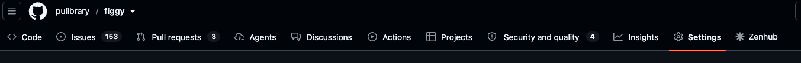
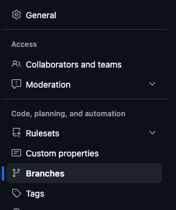
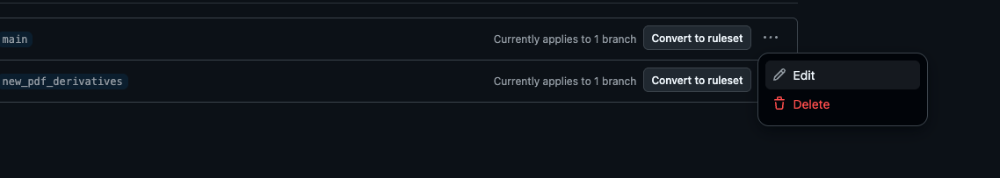
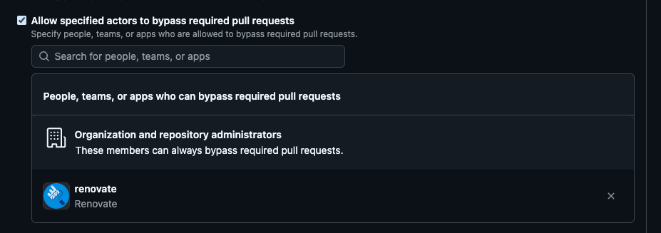
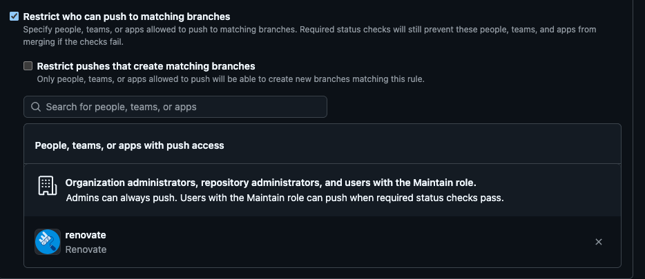
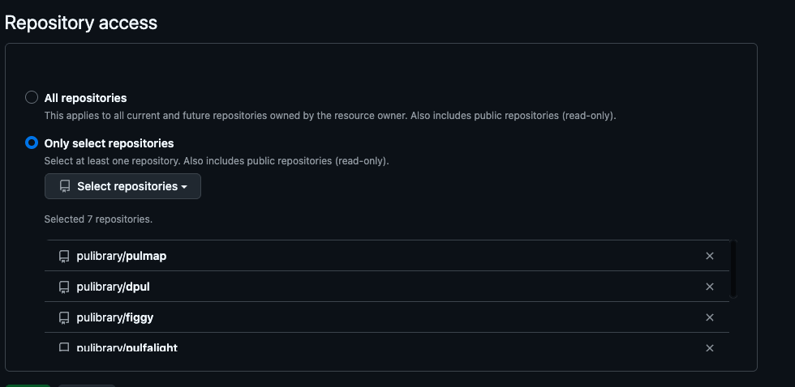

# Renovate

[Renovate](https://docs.renovatebot.com/) is a hosted service that can automatically update dependencies for us, much like Dependabot. However, unlike dependabot, it's able to reliably group up patches, is open source, and has many options to customize how you handle automated dependency updates.

## Installation & Setup

Renovate has a [tutorial](https://github.com/renovatebot/tutorial).

We've also made a [video](https://figgy.princeton.edu/catalog/500b4eda-f9cc-43e3-a99e-9dc0202456cc) showing us adding Renovate to one of our applications.

## Auto-Merge

To update Renovate so it auto-merges its PRs, you have to set up a few things:

**WARNING**: Make sure your package managers have a cooldown set, so that it doesn't automatically get the latest version of everything (in case there's a supply chain attack). We should wait at least 4 days before automatically patching. In Ruby use a recent version of Bundler and a cooldown on rubygems in the Gemfile, in NPM use whatever cooldown method is available in your dependency installer.

1. Update your renovate configuration to have `automerge: true`. You can find an example [in figgy](https://github.com/pulibrary/figgy/pull/7435/changes#diff-7b5c8955fc544a11b4b74eddb4115f9cc51c9cf162dbffa60d37eeed82a55a57) which adds auto-merge to lockfile maintenance and minor/patch version updates.
1. Update your github repository's branch protection rules for main:
    1. Go to Settings 
    1. Select "Branches" 
    1. Click the three dots next to "main", then "edit" 
    1. Scroll to "Allow specified actors to bypass required pull requests", search for "Renovate", and add Renovate. 
    1. Scroll to "Restrict who can push to matching branches", search for Renovate, and add Renovate. 
    1. Save Changes
1. Our repositories require one approver in Github, so we need Renovate's approval bot. It will auto-approve any PRs we've told it to auto-merge.
    1. Go to the [configuration page](https://github.com/organizations/pulibrary/settings/installations/181058364)
    1. Select your repository, then "Save" 
